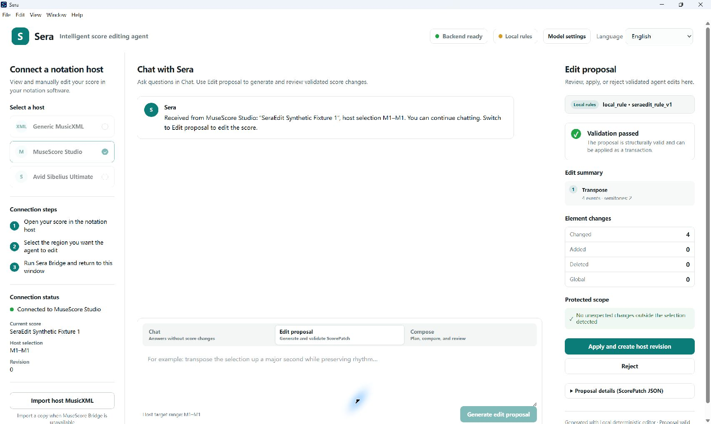
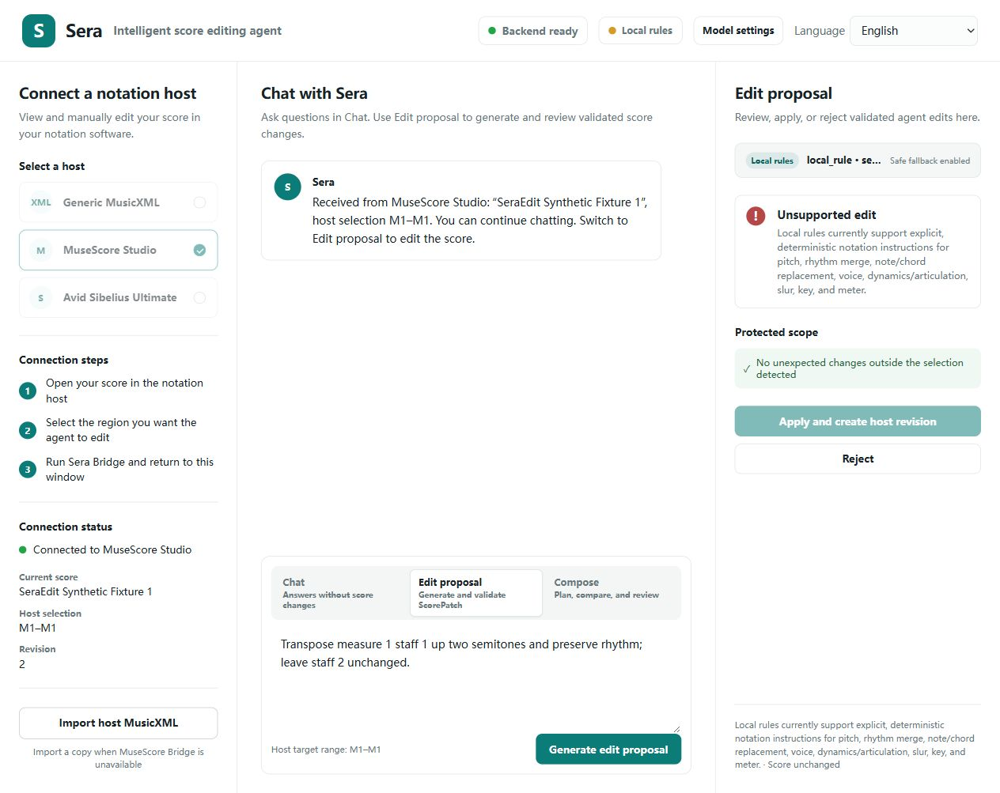
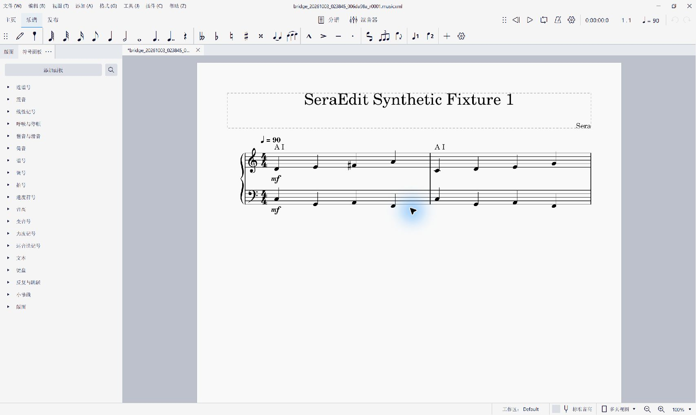

# SeraEdit: Scoped and Validated Language-Guided MusicXML Editing

**Yuan Gao**

**Zhejiang Conservatory of Music, No. 1 Zheyin Road, Zhuantang Street, Xihu District, Hangzhou, Zhejiang Province, China 310024**

**Corresponding author:** selanceg@gmail.com

**ORCID:** 0009-0005-0394-3623

## Abstract

SeraEdit represents language-guided MusicXML edits as source-bound, scoped ScorePatch
transactions with deterministic validation, rollback and user review. Its contribution
is reusable editing and evaluation software, not a new music model or guaranteed
accuracy improvement. Local processing supports offline use; optional remote models
receive score context. The packaged desktop and automated notation-host integration
target Windows; the Python reviewer path is documented separately. On 120 development
tasks, a DeepSeek demonstration completed 360 runs. Strict editing success was 72/110
for Full Rewrite, 65/110 for Patch Only and 63/110 for Sera Full. Sera Full had no
measured non-target changes among 73 output scores but erroneously refused 34
executable tasks. A constructed-error study rejected 180/180 invalid patches after
a documented detector fix, while round-trip limitations rejected 3/20 valid controls.
The software makes this protection/completion tradeoff inspectable and reproducible;
the results do not establish higher overall editing success or held-out generalization.

Keywords: MusicXML; symbolic music; score editing; structured patches; validation; research software

## 1. Motivation and significance

MusicXML exchanges common Western music notation among applications [1].
Natural-language interfaces could simplify transposition, dynamics or articulation
edits. Full-document model rewriting, however, exposes unrelated elements to change.
A well-formed response can alter an unselected staff, break a tie, change measure
duration, or drift from the reviewed source.

Existing symbolic-music toolkits provide rich programmatic analysis and generation
facilities [2,3], while recent work investigates music reasoning and generation with
large language models [4,5]. SeraEdit addresses a narrower systems problem: how to make
a language-guided edit inspectable, source-bound, minimal, and rejectable before it is
returned to a professional notation environment. The core research object is therefore
not a generated score but a transaction over a canonical score representation.

The software supports research into constrained generation, deterministic evaluation
of editing agents, error taxonomies, repair policies, and human-in-the-loop notation
workflows. Stable task fixtures and three separately implemented experimental conditions
allow investigators to compare full-document rewriting, unprotected structured patches,
and a fully validated transaction without changing the source score or metric code.
Executed tests already define acceptance in code-editing research: SWE-bench evaluates
repository issue resolution [8], Can It Edit? evaluates instruction-following code
changes [9], and CodeEditorBench covers multiple editing scenarios [6]. In music,
Not that Groove studies instruction-driven drum-groove editing with a textual symbolic
representation and annotated tests [10]. SeraEdit does not introduce language-guided
symbolic editing or test-based evaluation. Its narrower contribution is their
integration with pitched, multi-staff MusicXML: stable event addressing, source
fingerprints, explicit protected scopes, and a reversible transaction checked against
notation and export invariants. MuseScore Studio provides the notation-host context
through its plugin mechanism [11]. Citation metadata follows software-citation
principles [7]. These are contextual comparisons, not measured performance comparisons
against those external systems; different representations and task contracts prevent
a direct ranking from the present experiment.

The software contributes (1) a reusable ScorePatch contract for version-bound,
scoped MusicXML changes; (2) an executable validation, preview and rollback workflow
that makes acceptance independent of model confidence; and (3) licensed development
tasks, separate comparison conditions and saved-output recomputation tools. The live
comparison and fault-injection study demonstrate this infrastructure's research use,
including failures and rejection costs. They are bounded demonstrations rather than
claims of a superior model, universal correctness or improved musical quality.

## 2. Software description

### 2.1. Software architecture

Figure 1 summarizes the local pipeline. A MusicXML snapshot is imported into one
canonical `ScoreDocument`. Editable events receive stable identifiers, while a
canonical SHA-256 fingerprint identifies the exact source state. The renderer,
preview, patch executor, MIDI conversion, and exporter consume this same document;
the research pipeline does not maintain a hidden second score for playback or export.

**Figure 1.** The notation host remains the visual source. SeraEdit produces a separate
reviewed MusicXML revision or rejects the transaction while retaining the source.

### 2.2. Software functionalities

A `ScoreScope` deterministically selects measures, parts, staves, voices, event IDs,
and optional time ranges. Each patch declares a target scope, a protected scope, and
explicit exclusions. Its operations use a versioned JSON schema and describe selectors,
arguments, preconditions, and expected change counts. Implemented research operations
include pitch and duration changes, event insertion/deletion, dynamics, articulations,
ties, slurs, signature changes, voice moves, motif duplication, chord replacement,
and transactional batches. The product interface enables only operations whose host
round-trip contract is established; unknown operations fail as unsupported rather than
becoming silent no-ops.

The validation terminology is fixed to eight checks: source binding, schema,
structure and addressing, measure duration, notation relations, declared semantic
conditions, protected scope, and MusicXML round-trip fidelity. Source binding and
pre-apply checks precede cloning and operation application; post-apply checks precede
commit. Only implemented properties are checked: a valid transaction is not proof
that unrestricted musical intent was satisfied. Section 3.2 measures specific faults.
The result includes errors, a human-readable diff, fingerprints and snapshots for
undo/redo. Deterministic repair normalizes formatting or enums. Bounded model repair
receives errors and immutable scopes; it cannot bypass the transaction.

Provider adapters share a response contract recording model, latency, token use,
estimated cost, request ID, finish reason, raw output, parsed output, and normalized
errors. API keys are external to source and experiment artifacts. The desktop agent can
respond locally first and refine a high-level plan asynchronously with an optional LLM,
so provider latency does not block access to local safe candidates. Neither response is
auto-applied.

The three condition names are used consistently throughout: Full Rewrite
(`full_rewrite`, formerly Full-Score Rewrite) accepts complete MusicXML without the
patch validation/repair pipeline; Patch Only (`patch_only`, formerly ScorePatch Only)
parses and basically applies a patch; Sera Full (`sera_full`, formerly Sera Full
Pipeline) adds the eight checks, bounded repair/refusal, atomic execution and undo.
Immutable run IDs, hashes, saved responses and deterministic metric recomputation
support auditing. Section 3.1 defines the comparison and scoring denominators.

### 2.3. Platform and local-processing boundary

The packaged Electron desktop, automatic host discovery and stored-credential UI
currently target Windows. Source-level Python reviewer commands do not require the
desktop or MuseScore. POSIX installation and API commands are provided in the guide;
this revision was tested on Windows, so it does not claim independently verified
macOS/Linux desktop or bridge support. Non-Windows users can use the source-level
reviewer path and manually open exported MusicXML in their notation application;
that is not the automated bridge. Optional providers use environment variables off
Windows. Local-first means local score state, files and deterministic execution;
remote-model mode transmits instruction and score context to the chosen provider.

## 3. Illustrative examples

The local-rule demonstration uses: “Transpose measure 1 of staff 1 up by a major
second while preserving rhythm.” SeraEdit binds the candidate to the imported
fingerprint and resolves only pitched events in measure 1, staff 1. Preview applies
the transposition to a clone. Duration equality is checked with rational values,
protected content is compared event-by-event, and the exported MusicXML must parse,
import, export, and parse again. A valid preview reports the exact changed event count;
a stale fingerprint, missing event, duration change, or protected-scope difference rejects
and rolls back the whole patch.

The optional MuseScore bridge sends selection context and a user-selected saved
score to Sera Desktop. On MuseScore 4.5.2, native files use CLI conversion because
QML export is unavailable; MusicXML files are read directly. Users must save first:
unsaved in-memory changes are excluded. Review and apply creates a separate revision
opened in MuseScore, preserving the original. A captured local-rule demonstration
verified this complete path and four pitch changes (Figures 2 and 4;
BRIDGE_VISUAL_ACCEPTANCE.json). Final visual review and saving remain user actions.
Sera undo creates another revision; single-step host undo is not implemented.

**Figure 2.** Actual Electron development shell after MuseScore plugin handoff of a
saved synthetic score. Local rules propose four pitch changes with validation,
protection and apply/reject controls. This demonstrates the workflow, not live-model accuracy.

**Figure 3.** Source-browser UI after manual MusicXML import: an unsupported local-rule instruction. Apply is disabled and the
score is unchanged. This is an observed wording limitation, not a simulated error.
Additional applied/undo states and reproduction steps accompany the revision.

**Figure 4.** MuseScore 4.5.2 displaying revision 1 opened by the plugin. Measure 1,
staff 1 changes C–D–E–G to D–E–F♯–A; other notes remain unchanged.

For offline verification, the repository contains 20 short CC0 synthetic scores and
120 tasks spanning transposition, rhythm, harmony/key, voice/texture, dynamics,
insertion/deletion, ties/slurs, meter, compound edits, and expected refusal. Tasks carry
target/protected scope and deterministic expected constraints. The fixture provider
returns known outputs to exercise all runner and metric paths without network access or
token cost.

For review, `scripts/run_reviewer_demo.py` runs six representative tasks through the
actual local product entry point and writes a compact evidence report plus five
host-openable MusicXML revisions (the sixth task is an expected refusal). It requires
neither an API key nor a network connection. The included Windows CI workflow repeats
the Python regression suite, benchmark validation, this reviewer demo, package audit,
frontend tests, and production build on each push or pull request.

Automatic benchmark validation accepted 120/120 task definitions. The retained
human inspection completed 120/120
current primary decisions and a stratified 30/30 repeat check with zero stale records;
all current decisions were compliant after the correction cycle. The append-only export
retains 194 records, including superseded revision findings. Both passes used the same
pseudonymous reviewer, so these data verify task instructions, scopes, Gold outputs,
and host-visible notation but do not measure inter-rater reliability.

Software verification was repeated on 2 October 2026 on Windows 11 (build
10.0.26200) with Python 3.12.5 and a newly installed dependency environment. The
clean revision checkout passed all 438 collected Python tests. The new
`softwarex_revision_verification_120_v2` fixture completed 360 task-condition cases
with zero execution errors. Independent recomputation matched all 360 saved metric
rows, and all 13 integrity checks passed, including input, dependency, provider-output
and human-review file hashes. The original fixture is retained as historical
evidence: the revision audit identified stale benchmark/dependency hashes and six
metric rows inconsistent with the released task definitions. The corrected snapshot
has a separate identifier and does not amend the original deposited artifact.
These are software
verification results, not evidence that a language model achieves perfect edits; the
experiment manifest explicitly sets `formal_results_allowed` to false.

We additionally replayed every benchmark instruction through the interactive product
entry point without supplying its Gold patch to generation. Across English and Chinese
instructions and three deterministic repetitions, 720/720 runs completed generation or
the expected refusal, transaction preview, atomic commit, protected-scope checking,
deterministic constraints, and MusicXML export/re-import. All 660 executable runs
produced valid MusicXML; 60 conflict runs refused safely; no unsafe execution occurred.
Patch and result fingerprints were identical in all 240 repeated task-language groups.
After correcting a Chinese `preserve pitch`/tenuto ambiguity exposed by cross-language
comparison, all 120 task groups also produced semantically equivalent patches and
identical final score fingerprints across English and Chinese.
The rule generator was therefore adjusted using feedback from these same benchmark
instructions. These runs are regression evidence on a development benchmark, not a
held-out generalization evaluation; withholding Gold patches during generation does
not change that distinction. The 720 executions represent 120 tasks with language
variants and repetitions, not 720 independent tasks.
The compact publication snapshot retains all run metrics and hashes for all 1,380 raw
and host evidence files, plus 220 host-openable outputs for complete task review. This
establishes deterministic product-path acceptance,
not remote-LLM accuracy or human musical quality.

We separately tested localization when the notation host supplied a wider selection
than the measure named in the instruction. The robustness runner added one adjacent
measure to each eligible explicit-measure request. It passed 240/240 bilingual runs;
expansion was applicable in 174 runs, and all 174 retained the intended task result,
protected content, and valid MusicXML. The remaining 66 runs were not widened because
the instruction did not name a specific measure, the source lacked an adjacent measure,
or the operation was global. This regression set directly tests host-selection versus
semantic-target resolution and remains deterministic product evidence, not model accuracy.

### 3.1. Real-provider demonstration

On 2 October 2026, we ran all three conditions once on each of the 120 development
tasks using the DeepSeek API alias `deepseek-flash`. The API does not identify an
immutable model snapshot. The frozen producer was commit `e3a34e1`, with temperature
zero, thinking disabled, an 8,192-token output limit, no cache or transport retries,
and at most two model repairs for Sera Full. The answer-blind protocol provides
instruction, source and user scopes, excluding Gold patches, expected-status labels,
scoring constraints and unsupported reasons. Both patch conditions receive identical
initial messages and schemas, but generate separate responses. Only Sera Full receives
repair, so this is a system comparison, not an equal-call-budget comparison.

Two retained six-task pilots preceded the core run. The first revealed ambiguous
public documentation of typed patch assertions; we clarified that documentation
identically for both patch conditions before freezing the core run. Pilot tasks
overlap the core benchmark. Neither this development benchmark nor the pilot-informed
protocol establishes held-out generalization. No metric or producer implementation
was changed after observing the core results.

Strict editing success requires the frozen task constraints, valid MusicXML, complete
non-target preservation, an actual score output and no refusal. The 110 executable
tasks and 10 expected-refusal tasks have separate denominators. Leakage counts scores
with any measured non-target change among produced editing scores; withheld outputs
cannot establish successful editing.

| Condition | Strict editing success | Produced scores | Scores with leakage | Correct refusal | Erroneous editing refusal |
| --- | ---: | ---: | ---: | ---: | ---: |
| Full Rewrite | 72/110 (65.5%) | 105 | 17/105 | 10/10 | 5/110 |
| Patch Only | 65/110 (59.1%) | 92 | 18/92 | 10/10 | 10/110 |
| Sera Full | 63/110 (57.3%) | 73 | 0/73 | 10/10 | 34/110 |

These results do not demonstrate higher overall editing success for structured
patches. Sera Full constrained measured leakage while reducing output coverage.
An exploratory paired bootstrap over the 20 source-score clusters (5,000 resamples)
gave a Sera Full minus Full Rewrite strict-success difference of -8.18 percentage
points, with a 95% interval of [-21.10, 5.50]. This small development-set comparison
does not establish superiority or population-wide equivalence. Scoring follows
operational benchmark constraints: for example, the insertion task requires deletion
and insertion even if an in-place pitch change might satisfy a musician's reading of
“replace the final note.” We retain this limitation without changing scoring post hoc.

All 360 initial generations and 43 repair responses were returned without provider
failures or token-limit termination. Independent offline recomputation reproduced
all 360 metric rows and passed 14 integrity checks. Replay of the same initial Sera
Full responses with model repair disabled yielded 62/120 correct outcomes (strict
edits plus correct refusals), compared with 73/120 after repair: 11 improvements and
no regressions. However, 25 repaired editing tasks ended in erroneous refusal.
Median recorded latency was 9.93, 2.05 and 2.27 seconds for Full Rewrite, Patch Only
and Sera Full, respectively. Estimated main-run cost was USD 1.03 using configured
peak/cache-miss rates; this is not a billing receipt. Raw outputs, repair requests,
per-task metrics, costs and exploratory analyses accompany the revision evidence.

### 3.2. Constructed-error detection

We tested nine labeled mutation families on each of the 20 synthetic sources, plus
one canonical-valid dynamic-edit control per source: 180 invalid cases and 20 controls.
The families cover malformed schema, stale fingerprint, missing event, duration,
orphan tie/slur, protected-scope change, pitch-preservation violation and incorrect
declared dynamics. The study exposed an ignored `dynamic_equals` postcondition;
after implementing its event/value check, targeted detection improved from 0/20 to
20/20 on those same cases. All 180 invalid patches were rejected after the fix.
Pre-fix outputs are retained, and this same-case result is regression evidence.

Three of 20 canonical-valid controls were also rejected because grace-note dynamics
changed during MusicXML export/re-import. This 15% end-to-end rejection rate measures
an export/representation limitation, not isolated validator false positives. All 200
caller inputs remained unchanged and all 183 rejected transactions retained their
original fingerprints. Constructed mutations do not estimate real-model error
prevalence or prove detection of arbitrary semantic errors. The final implementation
passed 445 Python tests, extending the earlier 438-test reproducibility checkpoint.

| Evidence layer | Scale | Verified result | Claim boundary |
| --- | ---: | --- | --- |
| Benchmark definition | 120 tasks / 20 scores | 120/120 valid | Schema, Gold application, constraints, round trip |
| Automated regression | 445 Python tests | All passed | Final live-protocol revision checkout; earlier archive checkpoint had 438 |
| Real-provider comparison | 360 runs / 120 tasks | Strict edits: 72, 65, 63 of 110; 14 integrity checks | One API alias and development benchmark; protection/coverage tradeoff |
| Constructed-error detection | 180 mutations + 20 controls | 180 invalid rejected; 3 controls rejected | Regression after a detector fix; round-trip limitation retained |
| Reviewer demo | 6 representative tasks | 6/6 passed; five host files | Offline product-path reproducibility |
| Product replay | 720 bilingual runs | 720/720; 660 host exports | Deterministic local generator, not remote-LLM accuracy |
| Wider host selection | 240 bilingual runs | 240/240; 174 widened, 66 not widened | Semantic target remains narrower than authorization |
| Human task review | 120 primary + 30 repeat | Complete; zero stale | Same reviewer; no inter-rater or aesthetic claim |

## 4. Impact

SeraEdit makes failure observable and reusable as research data. A rejected request is
classified by stage—for example malformed patch, invalid selector, duration mismatch,
broken relation, protected-scope violation, incomplete execution, over-editing, conflict,
unsupported operation, or provider timeout—instead of being reduced to an application
error. Raw outputs and post-hoc deterministic metrics support studies of which safeguards
contribute to validity, task completion, non-target preservation, minimality, repair,
and refusal behavior.

Researchers can reuse the front end, provider adapters, transaction engine and
reporting pipeline with additional licensed fixtures. Mock runs support continuous
integration and teaching; API-backed runs remain separate. The interface exposes
these contracts to notation users.

The main empirical implication is that constrained acceptance and task completion
can diverge. The preserved failures support separate investigation of proposal
quality, repair, score representability and operational scoring. Improving completion
while retaining protection requires new evaluation; neither current results nor the
architecture alone guarantee that improvement. These components can support later
agent research, but this paper does not establish long-horizon composition or learned
musical intelligence.

The architecture also supports future interaction studies, with musical acceptance
remaining a human judgment.

Current evidence supports reliability engineering, human-checked benchmark semantics,
and reproducible experiment execution, not universal musical correctness or aesthetic
improvement. The fixtures are small and synthetic, and the repeated check was performed
by the same reviewer rather than an independent panel. The canonical importer is strongest
for common short MusicXML passages and does not establish universal handling of tuplets,
grace relations, complex cross-voice notation, or every notation application. MuseScore
has an exercised bridge; Sibelius interoperability is not yet verified. Live-provider
quality, latency, and cost can change with model versions and networks. Structural
orchestration and unrestricted composition remain outside the host-safe contract.
The real-provider demonstration shows reduced measured leakage at the cost of more
refusals, not improved overall editing success. Results depend on the task scorer,
small synthetic development set and optional repair budget. Deterministic validators
check implemented properties, not unrestricted musical intent or aesthetic quality.

## 5. Conclusions

SeraEdit packages language-guided MusicXML editing as a source-bound, scoped, validated,
and reversible transaction. Its principal contribution is an executable reliability
boundary: the model proposes, while canonical score state, deterministic validators,
protected-scope comparison, MusicXML round trips, and user review decide whether a
revision exists. Future releases will prioritize held-out comparisons across models,
cross-host testing, richer exact notation relations, and independent blinded musician
evaluation rather than weakening transaction safeguards.

## Code metadata

The following links identify the unchanged original public release. The new revision
code and evidence are local candidates; final archival links must be supplied before
submission. The original deposit does not contain the new live-model results.

| Nr. | Code metadata description | Metadata |
| --- | --- | --- |
| C1 | Current code version | `1.0.0` |
| C2 | Permanent link to code/repository used for this code version | `https://github.com/Selancee/Sera/releases/tag/v1.0.0` |
| C3 | Permanent link to reproducible capsule | `https://doi.org/10.5281/zenodo.22128976` |
| C4 | Legal code license | MIT; benchmark data CC0-1.0 |
| C5 | Code versioning system used | Git |
| C6 | Software code languages, tools and services used | Python, TypeScript/JavaScript, React, FastAPI, Electron, QML, PowerShell, MusicXML |
| C7 | Compilation requirements, operating environments and dependencies | Python >=3.10; Node.js/npm for interface development; verified Windows 11 build 10.0.26200, Python 3.12.5, Node.js 24.16.0, npm 11.13.0; Windows desktop package; POSIX source instructions with no independent platform validation; tested constraints and npm lock files |
| C8 | Developer documentation/manual | `docs/softwarex/API_REFERENCE.md`, `INSTALLATION.md`, `USER_MANUAL.md`, `REVIEWER_GUIDE.md`, and generated OpenAPI `/docs` |
| C9 | Support email for questions | `selanceg@gmail.com` |

## Software metadata

| Nr. | Software metadata description | Metadata |
| --- | --- | --- |
| S1 | Current executable software version | `1.0.0` |
| S2 | Permanent link to executable | `https://github.com/Selancee/Sera/releases/download/v1.0.0/Sera-1.0.0-x64.exe` |
| S3 | Permanent link to reproducible capsule | `https://doi.org/10.5281/zenodo.22128976` |
| S4 | Legal software license | MIT |
| S5 | Computing platforms/operating systems | Windows 10/11 x64; source-level core also uses Python >=3.10 |
| S6 | Installation requirements and dependencies | See `docs/softwarex/INSTALLATION.md` |
| S7 | User manual | `docs/softwarex/USER_MANUAL.md` |
| S8 | Support email | `selanceg@gmail.com` |

## Author contributions

`Yuan Gao: Conceptualization, Methodology, Software, Validation, Investigation,
Data curation, Writing – original draft, Writing – review & editing, Visualization.`

## Funding

This research did not receive any specific grant from funding agencies in the public,
commercial, or not-for-profit sectors.

## Declaration of competing interest

The author declares that there are no known competing financial interests or personal
relationships that could have appeared to influence the work reported in this paper.

## Data and code availability

Source code, synthetic benchmark data, test fixtures, evaluation configuration, and
the non-formal verification run are available from the tagged public repository in
C2 and the immutable Zenodo software deposit in C3 at
`https://doi.org/10.5281/zenodo.22128976`. No API key is distributed.
The separate revision evidence includes `softwarex_revision_verification_120_v2`,
`softwarex_deepseek_core_20261002_v1`, both retained DeepSeek pilots and
`softwarex_validator_detection_200_v1`. These local candidates include saved outputs
and offline recomputation commands; publication of the revised archive is pending.

## Declaration of generative AI and AI-assisted technologies in the manuscript preparation process

During preparation of this work, the author used OpenAI Codex to assist with source
code implementation, testing, documentation structuring, and language editing. The
author reviewed and edited all generated material and takes full responsibility for
the content of the publication. No AI system is listed as an author.

## References

[1] M. Good (Ed.), MusicXML 4.0, W3C Music Notation Community Group Final Report, 2021.  
[2] M. S. Cuthbert, C. Ariza, music21: A toolkit for computer-aided musicology and symbolic music data, ISMIR, 2010, 637–642.  
[3] C. Raffel, D. P. W. Ellis, Intuitive analysis, creation and manipulation of MIDI data with pretty_midi, ISMIR Late-Breaking/Demo, 2014.  
[4] R. Yuan et al., ChatMusician: Understanding and generating music intrinsically with LLM, Findings of ACL, 2024.  
[5] Z. Zhou et al., Can LLMs “reason” in music? An evaluation of LLMs' capability of music understanding and generation, ISMIR, 2024.  
[6] J. Guo et al., CodeEditorBench: Evaluating code editing capability of large language models, arXiv:2404.03543, 2024.  
[7] A. M. Smith, D. S. Katz, K. E. Niemeyer, FORCE11 Software Citation Working Group, Software citation principles, PeerJ Computer Science 2 (2016) e86. https://doi.org/10.7717/peerj-cs.86.

[8] C. E. Jimenez, J. Yang, A. Wettig, S. Yao, K. Pei, O. Press, K. Narasimhan, SWE-bench: Can Language Models Resolve Real-World GitHub Issues?, ICLR, 2024; preprint 2023. https://arxiv.org/abs/2310.06770.
[9] F. Cassano et al., Can It Edit? Evaluating the Ability of Large Language Models to Follow Code Editing Instructions, arXiv:2312.12450, 2023, revised 2024. https://arxiv.org/abs/2312.12450.
[10] L. Zhang, Not that Groove: Zero-Shot Symbolic Music Editing, arXiv:2505.08203v1, 2025. https://arxiv.org/abs/2505.08203v1.
[11] MuseScore, MuseScore Studio Handbook: Plugins, https://handbook.musescore.org/customization/plugins (accessed 3 October 2026).
